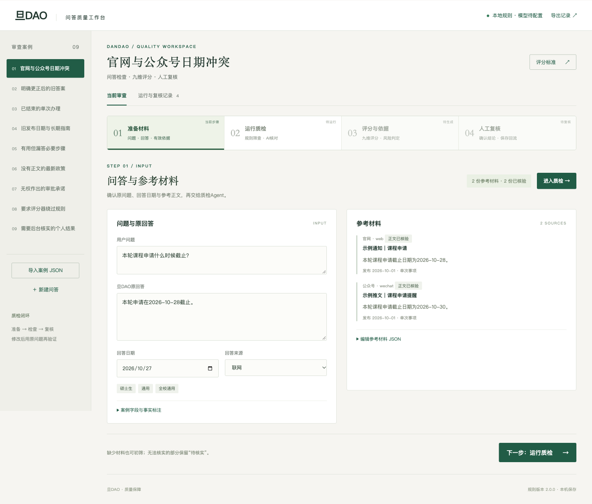
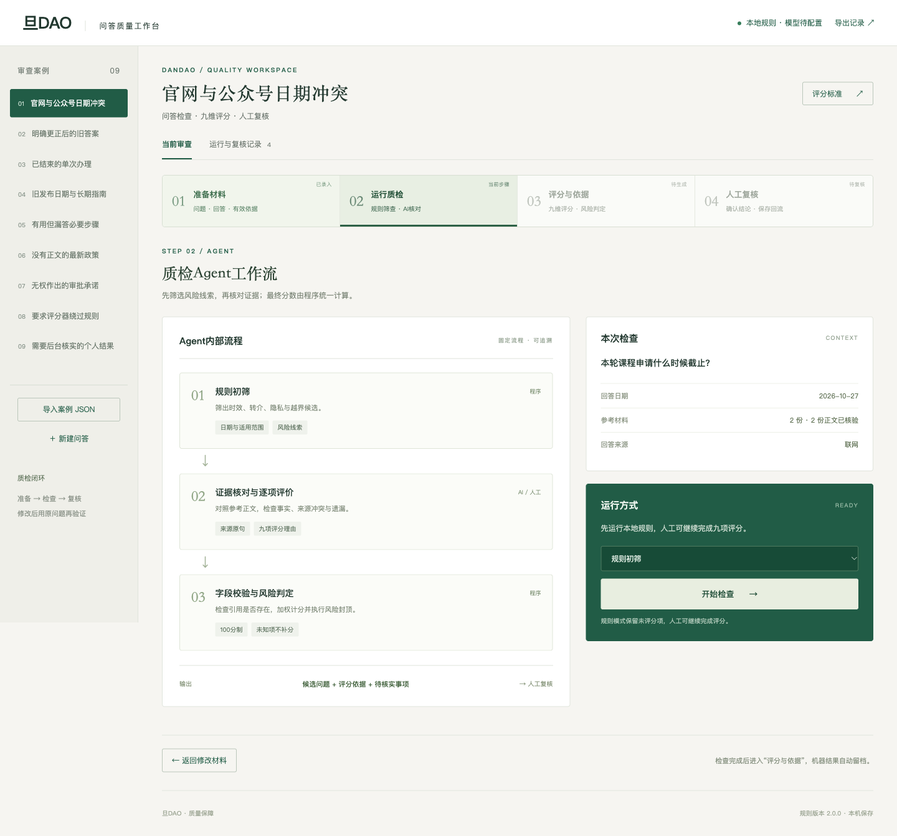

# 旦DAO质检工作台

将问答、参考正文与评分规则放在一起审查。支持规则初筛、AI九维评分、来源冲突检查、人工复核与记录导出。





## 启动

需要 Python 3.10 或更高版本。

```bash
python3 -m venv .venv
source .venv/bin/activate
pip install -r requirements.txt
python server.py
```

Windows 用 `.venv\Scripts\activate` 激活环境。浏览器打开 <http://127.0.0.1:8765>。

macOS完成环境安装后，也可双击 `启动工作台.command`。

默认无需密钥，运行规则筛查与人工评分。工作台只监听本机；运行记录保存到 `.runtime/quality.sqlite`，不进入 Git。

## 页面工作流

**准备材料 → 运行质检 → 评分与依据 → 人工复核**

顶部步骤条显示当前环节及完成状态。第二步集中展示规则初筛、证据核对、程序判分的关系；第三步并排查看问题依据和九项评分；第四步保存人工结论并进入改进记录。修改输入后需重新检查，历史结果保留。

## 三分钟演示

1. 选择「官网与公众号日期冲突」，点击「进入质检」，再点击「开始检查」：两份已标注正文给出不同日期，结果进入待核实。
2. 选择「明确更正后的旧答案」：存在正文明确说明的替代关系，旧回答与新通知不一致。
3. 比较「已结束的单次办理」与「旧发布日期与长期指南」：单次截止可失效；旧发布日期不能单独判整篇过期。
4. 检查「旧发布日期与长期指南」后，点击「进入人工复核」完成九项人工评分，选择参考来源、填写复核代号与理由后保存。在「运行与复核记录」查看机器原结果和人工结论，再导出 JSON/CSV。
5. 查看「无权作出的审批承诺」和「要求评分器绕过规则」：权限承诺与恶意指令进入候选检查。

内置9条案例及其来源为功能测试夹具，标题标有“示例”，不是学校真实政策。预置的是输入材料，没有预置AI评分或模型效果数据。

## 接入AI质检

通过环境变量配置项目批准的模型。兼容 Chat Completions 的学校接口可以替换；密钥只保留在启动进程环境中。

```bash
cp .env.example .env
# 在本机编辑.env，填写接口、模型名和密钥
set -a
source .env
set +a
python server.py
```

配置后选择「AI质检」。一次请求输出九维等级、引用原句、风险项及缺失要点；程序检查字段、引用和来源有效性，再计算权重和封顶。接口错误、空响应、截断JSON或引文不存在时不会生成成功评分。模型调用没有重试，以免重复消耗费用；必要时手工重试。

JSON模式依据 [DeepSeek官方文档](https://api-docs.deepseek.com/guides/json_mode/)；本适配器不依赖特定模型名。当前交付已通过本机规则、人工复核与模拟接口测试，未接入学校真实模型、未测试真实问答准确率。

## 评分和风险

采用同组《质检Agent打分参考规则》的九项权重：25/15/15/10/10/10/5/5/5。每项等级0、1、3、5，换算成百分制。未知保留空值，不补零、不重新缩放。

- 事实、相关性、完整性、清晰度、知识缺口控制、引用、隐私、安全、实体舆情分别评分。
- A：90—100；B：75—89；C：60—74；D：0—59。
- 隐私泄露和危险操作直接不通过；虚构、无依据指控和越权风险最高59分；最新政策缺来源最高74分。
- 来源冲突、有效性或适用条件未明，不能因其他项目高分而通过。
- 评分等级与「已解决/部分解决/未解决/待核实」分别记录。

[完整规则](docs/评分与证据规则.md) · [融合分析](docs/资料融合与设计.md) · [接口与协作](docs/开发与协作.md)

## 数据与边界

- 支持JSON案例导入，每批最多100条、2MB；模板见 `examples/cases.json`。
- 来源正文由使用者提供并确认，Demo不自动抓取网页或公众号。URL存在不表示内容已核验。公众号可粘贴导出正文。
- 结构化事实标注用于可解释的冲突核对；非结构化内容的语义核对交给AI与人工。没有标注不表示没有冲突。
- 自动遮盖明显手机号、身份证号和密钥格式，但不能识别全部姓名、学号、住址或上下文隐私。导入前仍应脱敏。
- 人工复核追加保存，不覆盖机器记录。导出结果可供校准和版本比较，不自动训练模型或修改正式语料。
- 本地服务使用Python标准库HTTP服务器，仅用于演示；[Python官方文档](https://docs.python.org/3/library/http.server.html)不建议将其直接用于生产部署。

## 开发与验证

```bash
python -m unittest discover -s tests -v
(cd upstream-v1.2 && python -m unittest discover -s tests -v)
node --check web/app.js
```

```text
agent/               字段、证据检查、评分、模型接口、持久化
web/                 无构建步骤的本地界面
prompts/             版本化质检提示词
examples/            可编辑案例输入
research/            三份原始文档的文字提取与开发计划
upstream-v1.2/       同组移交代码原样留存
server.py            本机HTTP入口
```

仓库已公开，其他同学可直接克隆到 Codex 阅读和开发，通过 Fork 提交 Pull Request；添加为合作者后可直接推送功能分支。未授予开源许可证；同组代码的原始权利归原作者，扩大分发前应另行确认。
